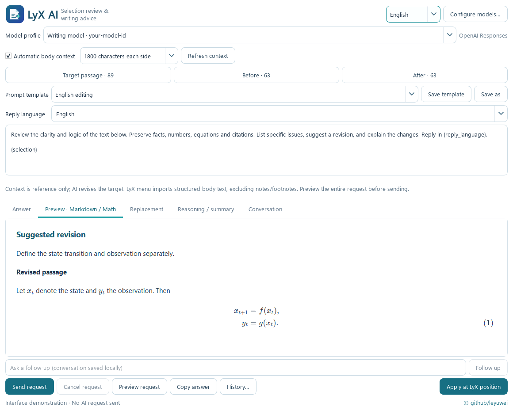
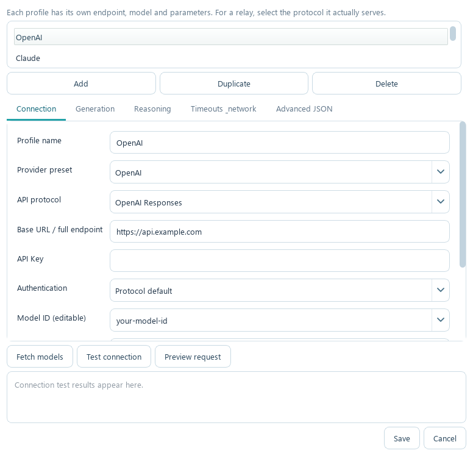
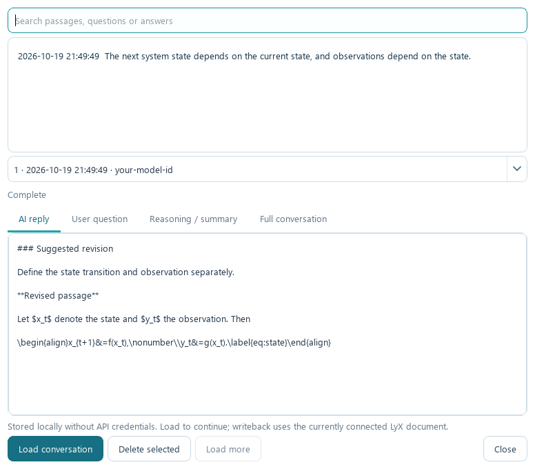

# LyX AI

**Give AI the surrounding prose, then apply revised text and editable equations directly in LyX.**

[简体中文](README.md) · **English**



*Actual application interface with illustrative content. No AI request was sent to create this screenshot.*

## From selection to revision, inside your writing workflow

Select a passage in the LyX document body and open the assistant from the context menu. Surrounding prose is collected automatically. Review the context, choose a prompt and model, read the suggestions, and apply the revision to the current LyX selection or caret.

**Select prose → Collect context → Ask AI → Preview text and equations → Apply the revision**

| Highlight | What it gives you |
|---|---|
| **Automatic body context** | Reads the live document, including unsaved edits. Collects a configurable amount of surrounding prose while excluding Note, Footnote and other block objects from main-body ranges. |
| **Uncluttered passage controls** | A consistent white interface stays readable. Three buttons show character counts; open a dialog to inspect or edit the target and surrounding context. |
| **Native equation writeback** | Inline, displayed and multiline align/aligned equations become editable LyX math objects, retaining supported numbering and label structures. |
| **Markdown and math preview** | Read headings, lists, tables and equations in an offline preview before using the revision. |
| **Your models and relay services** | Separate profiles for endpoints, protocols, keys, models, generation settings, reasoning, proxies and timeouts. |
| **Persistent preferences** | Reply language, selected and edited prompts, model, context radius and window layout are saved automatically, including a 1200-character context option. |
| **Local conversation history** | Read AI replies separately for each turn, with questions and reasoning in their own tabs. Search, reload and continue; partial replies survive failed or cancelled requests. |
| **Comfortable on small screens** | Screen-aware sizing, scrollable panels and a one-line status bar. Preview switches retain the window and page position. |
| **Prompts for writing tasks** | Edit or save templates for academic editing, proofreading, concision, logical flow, equations and translation; continue with follow-up questions. |
| **Reviewable, undoable changes** | Inspect the outgoing request, choose the current selection or caret as the destination, and undo the application in LyX with one action. |

## Connect your own models



*Configuration demonstration with placeholder endpoints and model IDs. No credentials are shown.*

Configuration presets cover OpenAI, Claude, DeepSeek, Kimi, Grok, GLM / BigModel, BigModel Coding, Z.ai and custom relay services. Choose **OpenAI Chat Completions, OpenAI Responses or Claude Messages** to match the protocol your endpoint serves.

Keep official endpoints and relay configurations in separate profiles. Configure generation parameters, reasoning mode and effort, output limits, custom headers and advanced JSON. Available parameters and model access depend on the service you connect to.

## Revise prose and equations together

Click **Target passage / Before / After** to inspect or edit text in a popup. Save commits changes for the next request; Cancel leaves the text unchanged. Automatic context collection still runs without opening these dialogs.

Applicable revisions are placed in a separate, editable **Replacement** area. Review or edit the passage, preview it, then use **Apply at LyX position** in the global bottom toolbar, available from every tab.

- Supports inline math, single-line displayed equations and multiline alignment, including standalone `align` and `aligned` environments.
- Preserves Theorem/Lemma target layouts and uses the native LyX importer for LaTeX environments and text formatting. ERT areas retain real LaTeX source for document typesetting.
- Keeps the target passage separate from preceding and following context, so the requested editing scope is clear.
- Converts `\eqref{…}`, `\ref{…}` and `\cite{…}` into native LyX objects so the document resolves their numbers and citations.
- Uses the latest destination: replaces the current selection or inserts at the current caret. You may move the selection or edit the same document while waiting; switching documents blocks writeback. Replacing a selection removes selected Note/Footnote and other non-body objects; one undo restores them.
- Follows the LyX UI language for context-menu labels. The assistant has its own persistent Chinese/English language setting.

## Revisit a conversation and continue



*Illustrative history entries; no AI request was sent for this screenshot.*

Use **History…** in the bottom toolbar. The default **AI reply** tab shows only the selected turn's answer; choose a turn to review earlier replies or follow-ups. Questions, reasoning and the full conversation have separate tabs. Search older records or load more results. Standalone startup restores the last conversation; opening a new selection from LyX starts a fresh target. Upgrades retain preferences and history.

Theorem environments require a matching Theorems module in the current document; see `examples/regions-demo.lyx`. Custom macros depend on the document configuration.

## A local companion with a visible sending scope

Installs in your user directory without modifying LyX program files. Credentials are protected by **Windows DPAPI / macOS Keychain**. Sent passages, surrounding context, answers and reasoning summaries are saved locally in `history.sqlite3`. Search, load or delete them through History; they are not automatically uploaded. Automatic context uses a temporary local document snapshot that is deleted after reading.

KaTeX and fonts are bundled for offline preview rendering. When you send a request, the passage and context in the input area go to your configured API. Inspect the complete request beforehand.

## Get started

**macOS 12 or newer:** extract the complete macOS package, quit LyX and the assistant, and run `Install-macOS.command`. The app installs into `~/Applications/LyXAI.app`. Open LyX normally and use its bilingual context menu; undo with **⌘Z**. See [macOS installation and builds](docs/INSTALL.macOS.md).

**Windows:**

1. Extract the complete Windows package. Save your work, close LyX and the assistant, and run `Install.cmd`.
2. Launch **LyX AI - Start LyX** from the Windows Start Menu. Select main-body prose and open the assistant from the context menu.
3. Open **Configure models**, enter your endpoint and credentials, and review the context and prompt before sending.
4. Check the revision in the preview, then use the global Apply button. Press **Ctrl+Z** in LyX to undo it.

An overwrite installation retains model profiles, prompts and language preferences. Keep the dependency folders with the executable. Try writeback on a document copy first, and select text from the main document body.

Run from source:

```powershell
python -m pip install -r requirements.txt
python main.py --configure
```

## Learn more

- [English quick start](docs/QUICKSTART.en.md)
- [Installation and removal — Chinese](docs/INSTALL.zh-CN.md) · [Upgrade guide — Chinese](docs/UPGRADE.zh-CN.md)
- [Usage, prompts and model parameters — Chinese](docs/USER-GUIDE.zh-CN.md)
- [Testing, verification and supported scope — Chinese](docs/TESTING.zh-CN.md)
- [Third-party components and licenses](docs/THIRD-PARTY.md)

---

© [github/leyuwei](https://github.com/leyuwei/LyX-AI)
