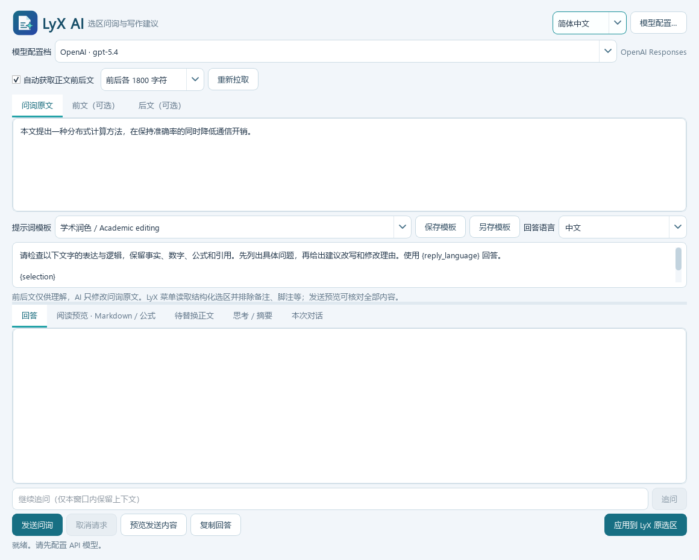

# LyX AI 0.3.1

Windows LyX 2.5 写作助手：框选正文后右键启动，自动获取正文上下文，离线显示 Markdown 与公式，将修改稿连同原生公式应用回 LyX。独立模型配置窗口支持多配置档、原生接口和中转站。

- [安装与卸载](docs/INSTALL.zh-CN.md)
- [覆盖升级教程](docs/UPGRADE.zh-CN.md)
- [使用说明与模型参数](docs/USER-GUIDE.zh-CN.md)
- [测试方式与验证边界](docs/TESTING.zh-CN.md)
- [English quick start](docs/QUICKSTART.en.md)

支持 OpenAI Chat Completions、OpenAI Responses、Claude Messages；预设 OpenAI、Claude、DeepSeek、Kimi、Grok、GLM / BigModel、BigModel Coding、Z.ai 和自定义中转。

从 LyX 导入时读取结构化选区，排除跨正文选区里的 Note、Foot、Marginal 等非正文对象。前后文仅作参考，AI 修改目标原文。原文、前文、后文和实际请求均可在发送前查看。

程序使用用户目录安装，不修改 LyX 程序文件。密钥、地址、代理和自定义认证头使用当前 Windows 账户的 DPAPI 加密。选区和对话不自动写入配置；自动上下文短暂导出本地文档快照，读取后删除。点击发送才提交文字到配置的 API。

当前为 0.3.1 测试版本。59 项快速回归、真实 LyX Server/结构化剪贴板/原生公式粘贴与撤销、离线公式渲染检查已通过。支持单行 Displayed 和 align/aligned 等多行公式，保留原生编号与标签；应用按钮位于全局底栏。内置 10 个模板，升级追加新模板而不覆盖用户编辑，界面语言保存后下次启动继续使用。文档和选区变化或目标含复杂结构时拒绝覆盖；真实桌面右键点击和真实 API 账户仍需短验收，请先用文档副本。

菜单使用 LyX 界面语言。默认安装生成用户级语言覆盖层；首次升级请从开始菜单 **LyX AI - Start LyX** 启动，旧入口必要时需注销登录后刷新环境。Logo、按钮、下拉框均已更新。

预览采用 [Qt WebEngine](https://doc.qt.io/qtforpython-6/PySide6/QtWebEngineWidgets/QWebEngineView.html) 与离线 [KaTeX](https://katex.org/docs/options.html)。KaTeX 0.16.22 的 MIT 许可证随资源分发。
