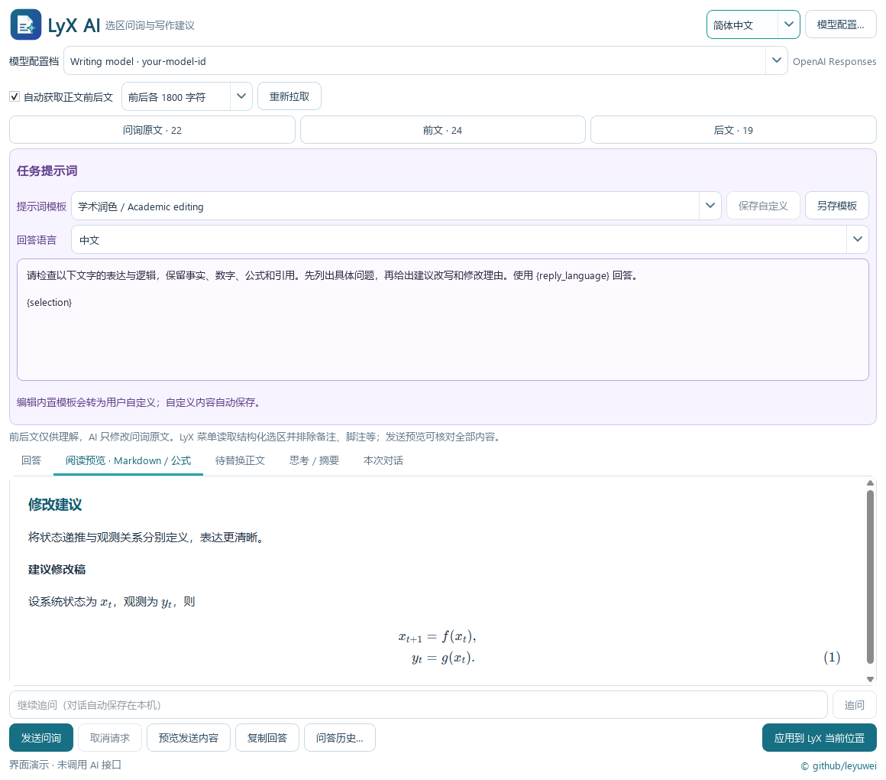
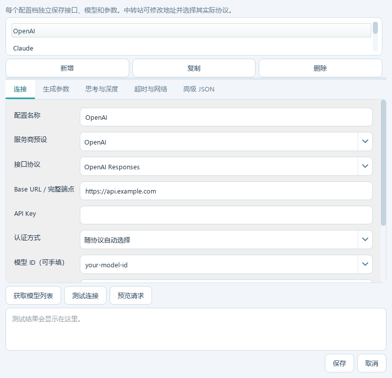

# LyX AI

**让 AI 读懂正文上下文，把修改后的文字与公式直接写回 LyX。**

**简体中文** · [English](README.en.md)



*实际程序界面，内容为演示示例；截图生成过程未调用 AI 接口。*

## 从选区到修改稿，留在写作流程里

在 LyX 正文中框选文字，右键打开助手。程序自动获取前后正文，你可以检查上下文、选择提示词和模型，再阅读建议，将确认后的修改应用到原选区。

**框选正文 → 自动补充上下文 → 问询 AI → 预览文字与公式 → 应用修改**

| 亮点 | 带来的便利 |
|---|---|
| **自动理解正文上下文** | 读取当前文档，包括未保存的编辑；按可选范围提取前后文，排除跨正文范围中的 Note、Footnote 等对象。 |
| **公式原生写回** | 行内、Displayed、align/aligned 等公式成为可继续编辑的 LyX 数学对象，保留支持的编号与标签结构。 |
| **Markdown 与公式阅读** | 标题、列表、表格与数学公式在离线预览中排版显示，便于核对建议与修改稿。 |
| **模型与中转站自由配置** | 多配置档管理地址、协议、密钥、模型、生成参数、思考深度、代理和超时。 |
| **可定制的写作任务** | 学术润色、语法校对、精简、逻辑检查、公式整理和中英翻译等模板可编辑、另存；支持继续追问。 |
| **可检查、可撤销的应用过程** | 发送前查看实际请求；应用前核对原文与选区；替换后可在 LyX 一次撤销。 |

## 连接你自己的模型



*配置界面演示，地址和模型为占位示例，不含密钥。*

提供 OpenAI、Claude、DeepSeek、Kimi、Grok、GLM / BigModel、BigModel Coding、Z.ai 和自定义中转的配置入口。支持 **OpenAI Chat Completions、OpenAI Responses、Claude Messages**，可按服务商或中转站实际提供的协议选择。

同一家服务可分别保存官方接口和中转配置。生成参数、思考模式与深度、输出上限、自定义请求头和高级 JSON 均可配置；具体可用参数与模型权限由接口服务决定。

## 文字与公式一起修改

助手把可应用的修改稿放进独立的“待替换正文”编辑区。你可以继续编辑和预览，再通过窗口底部始终可见的 **应用到 LyX 原选区** 按钮写回。

- 支持行内公式、单行 Displayed 和多行对齐公式，识别裸露的 `align`、`aligned` 等环境。
- 原文、前文、后文分别展示；前后文供模型理解，修改目标明确。
- 文档或选区变化时停止覆盖；含引用、脚注等复杂对象的目标会提示缩小范围。
- 菜单跟随 LyX 界面语言，助手可切换中英文，并记住语言选择。

## 本地助手，发送范围可见

程序安装在用户目录，不改写 LyX 程序文件。凭据由当前 Windows 账户的 **DPAPI** 加密保存；选区和会话不自动写入配置。自动上下文使用短暂的本地文档快照，读取后删除。

预览使用随程序分发的 KaTeX 与字体，无需联网下载渲染资源。点击发送后，输入区中的正文和上下文提交给你配置的 API；可事先查看完整请求。

## 开始使用

1. 将 Windows 安装包完整解压，保存文档并退出 LyX 和助手，运行 `Install.cmd`。
2. 从开始菜单 **LyX AI - Start LyX** 启动，在主正文框选文字并右键打开助手。
3. 在“模型配置…”中填写自己的接口和密钥，核对上下文与提示词后发送。
4. 预览并检查修改稿，再点击全局应用按钮；需要恢复时在 LyX 按 **Ctrl+Z**。

覆盖安装保留模型、模板和语言设置。完整依赖目录须与 EXE 一起保留。请先在文档副本上体验写回功能，并从主正文选取文本。

从源码运行：

```powershell
python -m pip install -r requirements.txt
python main.py --configure
```

## 进一步了解

- [安装与卸载](docs/INSTALL.zh-CN.md) · [覆盖升级](docs/UPGRADE.zh-CN.md)
- [使用说明、提示词与模型参数](docs/USER-GUIDE.zh-CN.md)
- [自动测试、实际验证与适用边界](docs/TESTING.zh-CN.md)
- [第三方组件与许可证说明](docs/THIRD-PARTY.md)
