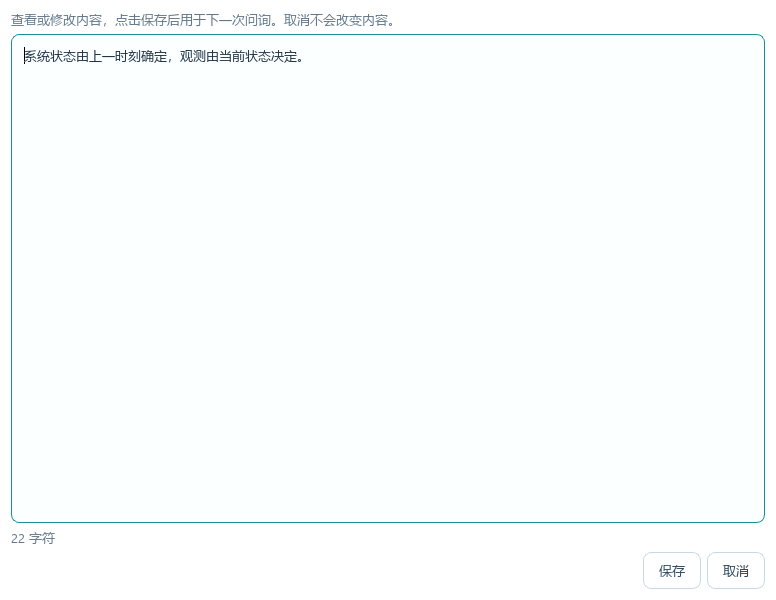
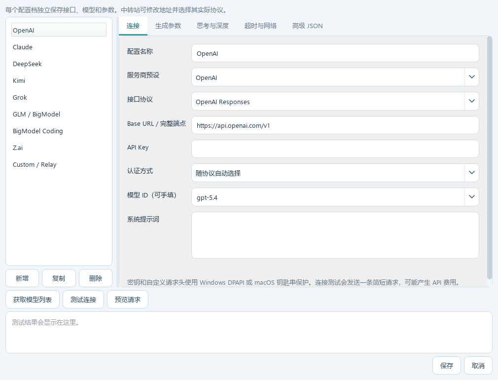
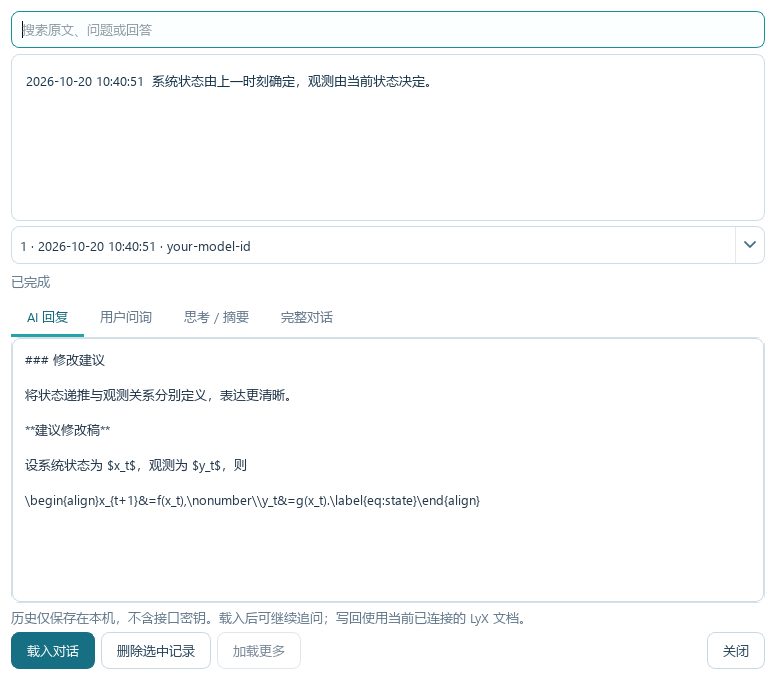

# 使用说明


## 问询原文与前后文

1. 在 LyX 主正文框选目标句段，右键“AI 写作助手… / AI Writing Assistant…”。
2. 助手自动读取当前内存文档，包括未保存的内容，并按记住的范围填入前后正文（默认前后各 1800 字符，可选 600、1200、1800、4000、8000）；Note、Foot 等对象被排除。
3. 可选前后各 600 / 1800 / 4000 / 8000 字符，点击“重新拉取”。原文必须在正文中能唯一定位，否则提示扩大选区或手动补充，不会取第一个匹配。
4. 主界面只显示“问询原文 / 前文 / 后文”三个按钮及字符数。需要核对或修改时点击相应按钮，在弹窗中编辑并“保存”；“取消”不改变内容。弹窗会记住窗口大小。仍可回到 LyX 框选额外正文，右键“补充 AI 前文 / 后文”追加到同一窗口；写回以当前选区或光标为准。
5. 选择提示词模板和回答语言；点击“预览发送内容”核对请求，再点击“发送问询”。

加入前后文不会覆盖问询原文，也不会自动调用 API。程序会把前文、目标原文、后文分别标记，明确告诉模型只修改目标原文。前文选择范围应止于原文之前，后文应始于原文之后，避免重复包含目标句。



弹窗修改只影响后续发送，不会立即改变 LyX 文档。若编辑期间 LyX 传入新的选区或上下文，保存时会保留新内容并提示重新编辑，避免旧弹窗覆盖新目标。主界面统一使用白色背景，在深色系统配色下也保持文字可读。

取消“自动获取正文前后文”后，下一次读取不再自动填入前后文；已有或手动输入的前后文仍会发送，如不需要请清空。仍在本地读取文档以确认安全写回目标。应用使用同一文档内最新的选区或光标位置；切换文档后需重新问询。

再次使用“问询 AI”代表开始一个新目标，会清空旧上下文、回答及会话。给已有目标添加上下文时，请使用“加入前文 / 加入后文”。添加上下文后，旧追问历史会清空，需要重新发送才能使用新上下文。请求进行中若收到新选区，助手会提示先取消或等待，不会中途替换正在发送的内容。

同一配置目录默认复用同一个助手窗口。关掉助手后没有常驻托盘或后台服务，下次取词会重新启动。

## 正文过滤范围

LyX AI 菜单读取的是 `application/x-lyx` 结构化剪贴板，跨正文选区内的 Note（含 Comment/Greyed Out）、Foot、Marginal、图片浮动体、表格、Branch 和未知块对象整块排除，包含它们的嵌套内容。保留主正文段落、常见行内文字样式、公式源码、引用键和交叉引用目标。修订中标记删除的文字排除。

输入框中的公式和引用保留 LaTeX，例如 `$E=mc^{2}$`、`\eqref{eq:demo}`、`\ref{sec:demo}`、`\cite{paper2026}`。写回时公式和引用转换为可编辑的原生 LyX 对象，编号由文档解析。未知对象采用排除策略，发送前请检查预览。

请从主正文框选范围。若进入一个已打开的 Note/Footnote 内部单独选中它的文字，LyX 可能只复制内部段落而不保留父对象类型；外部助手无法从这种片段判断其原本属于脚注。当前版本不声称能识别这种来源。手动粘贴的普通文字同样无法自动识别备注或脚注，必须自行排除。

如果结构不完整、没有结构化剪贴板或过滤后没有正文，导入会失败并显示原因，不会静默回退到普通文本或发送旧剪贴板。

## 模型配置窗口



点击右上角“模型配置…”。每个配置档独立保存，可以新增、复制、删除；保存生效，取消不改正式配置。可以为同一家服务同时保存“官方接口”和“中转接口”两个配置档。

### 连接

| 设置 | 用法 |
|---|---|
| 服务商预设 | 填入常见地址、协议和示例模型 ID；不保证你的账户有该模型权限 |
| 接口协议 | Chat Completions、Responses 或 Claude Messages，根据实际服务选择 |
| Base URL / 完整端点 | 官方地址可替换为中转地址；支持包含路径前缀的 Base URL，也支持完整生成端点 |
| API Key | 填当前地址对应的密钥；中转站通常使用中转站自己的密钥 |
| 认证方式 | 自动、Bearer、x-api-key，或仅使用自定义头 |
| 模型 ID | 可手填；也可点击“获取模型列表”，部分中转站没有列表接口时手填即可 |
| 系统提示词 | 作用于此配置档的全部问询；与主窗口里的任务模板分别设置 |

服务商与协议分开配置。例如中转站的 Claude 模型若通过 `/chat/completions` 提供，应选择 Chat Completions；只有实际提供 `/messages` 时才选择 Claude Messages。

支持的预设：OpenAI、Claude、DeepSeek、Kimi、Grok、GLM / BigModel、BigModel Coding、Z.ai、Custom / Relay。模型列表和预设 ID 只是入口，具体可用型号以服务商及你的账户为准。

BigModel 普通 API 与 Coding 套餐是不同端点、不同密钥体系。Coding 套餐有指定工具和用途限制，本扩展未获其官方认证；不能保证填写套餐端点即可使用套餐额度。

### 生成参数

提供 `temperature`、`top_p`、`top_k`、`presence_penalty`、`frequency_penalty`、`seed`、`stop`、最大输出 tokens 和流式开关。留空不发送，避免向所有模型强制提交同一组参数。

最大输出字段可自动选择，或手动选择 `max_tokens`、`max_completion_tokens`、`max_output_tokens`，用于适配中转站。Claude Messages 必须设置 `max_tokens`。

### 思考模式与深度

| 设置 | 行为 |
|---|---|
| 模型默认 | 不强行开启或关闭思考 |
| enabled / disabled | 映射到相应协议的思考控制字段 |
| adaptive | 用于支持自适应思考的 Claude Messages 模型 |
| Reasoning effort | 可选或手填深度值；具体允许哪些值取决于模型 |
| Claude 思考预算 | 手动 enabled 模式使用，至少 1024 tokens 且小于最大输出 |
| 输出详略 | 适用协议发送 verbosity；其他情况可用提示词控制 |

协议映射：Responses 使用 `reasoning.effort`，Chat Completions 使用 `reasoning_effort`，Claude Messages 使用 `output_config.effort`。部分模型只允许自适应思考，或不允许关闭；服务端错误会直接显示。界面中的可选值不是“每个模型全部支持”的承诺。

### 超时和代理

- 等待响应头：请求发出后等多久得到 HTTP 响应头。
- 读取空闲：响应过程中连续多久没有收到数据。
- 请求总时限：整个请求的最长时间，即使服务不断发送保活消息也会到期。

默认前两项各 120 秒，总时限 600 秒。长思考模型可以按需要延长。可以手填 HTTP 或 SOCKS5 代理；留空使用 Qt/系统默认网络设置。请求支持取消，不自动重试计费请求。

### 高级 JSON

可以为服务商和中转站添加新参数。下面只是格式示例，需确认模型支持：

```json
{
  "reasoning": {"summary": "auto"},
  "temperature": null
}
```

额外对象会合并进生成请求；同名值覆盖，`null` 用于移除自动生成的字段。不能覆盖模型、对话、流式开关及已有会话标识。此助手不执行工具调用；如果模型只返回工具请求而无文字，会显示无回答正文错误。

自定义请求头单独填写 JSON 对象，例如兼容特定代理的认证头或 Anthropic beta 头。头值加密保存，预览隐藏其值；不要把密钥写入提示词或文档。

## 提示词模板

紫色面板集中呈现提示词模板、回答语言和任务提示词。内置模板内容不可覆盖：第一次编辑立即切换为“用户自定义”，后续修改只更新这个自定义项，自动保存。切回内置项会恢复原始预设，自定义草稿仍在列表中；也可“另存模板”为命名任务。“保存自定义”可立即落盘。支持 `{selection}` 和 `{reply_language}`；未写 `{selection}` 时会自动附加原文。添加上下文后，`{selection}` 会包含分区标记后的前文、目标和后文。

内置 10 个模板：学术润色、English editing、错别字与语法、精简文字、逻辑与衔接、公式与符号检查、LaTeX 公式整理、中译英、英译中、审稿式诊断。内置内容从程序预设加载，配置只保存其标识和选择；仅自定义模板保存修改后的提示词。升级时，旧版本已改写的预设内容会迁移为自定义项，并恢复原来的内置内容；原有自定义项、选择和其他设置保留。

示例：

```text
检查目标原文的表达和论证衔接。前后文仅用于理解，不要改写。
保持数字、事实、公式和引用不变。
先指出问题，再给出修改稿，并解释理由。
使用 {reply_language} 回答。

{selection}
```

界面语言、原文语言、回答语言分别设置。切换界面语言会立即保存，关闭后下次打开继续使用；并保留当前原文、前后文和待替换正文。正在请求或与 LyX 通信时，暂时禁用语言开关，避免出现选择变了但没有保存的状态。

## 回答、取消与追问

“回答”页显示可选择的源码；“阅读预览”以 Markdown 排版，支持标题、加粗、列表、引用、代码和表格，以及行内和独立公式。“思考 / 摘要”只显示 API 实际返回的内容，不保证每个模型都有。“本次对话”用于查看当前窗口的会话。

回答完成后可继续追问。失败、取消或连接提前中断会保留部分输出，不把失败轮次加入成功会话。输出截断会提示，且不自动提取未完成修改。

## Markdown 和公式预览

首次显示主窗口前准备并复用浏览器控件，切换“阅读预览”不再重建窗口；相同内容不重复加载，保留页面滚动位置。编辑后延迟约 350 ms 合并渲染。使用随程序分发的 KaTeX，脚本和字体无需联网；不执行输出中的 HTML/JavaScript，不加载远程图片，外链不能在视图内打开。预览最多显示 25 万字符，源码页保留完整回答。

公式支持 `$…$`、`\(…\)`、`$$…$$`、`\[…\]` 和 equation、align、aligned、alignat、alignedat、gather、gathered、multline、split 等环境，包括相应的星号版本。无需给裸露的 align/aligned 再套定界符。单行 `\[x=1\]` 按 Displayed 显示。预览不解析文档引用标签，会隐藏 label 元数据；原生写回保留 label、nonumber 和编号意图。KaTeX 不支持的命令仍显示为红色源码；multline 预览以居中的多行方式近似显示，LyX 写回保留原环境。

## 将修改直接应用到 LyX

1. 助手附加输出约定：仅将目标修改稿放在 `[REVISED]` 与 `[/REVISED]` 之间，解释放在标记外。完整回答且只有一个块时，自动提取到“待替换正文”。
2. 若模型未遵循格式，可在“回答”源码中选中修改稿，然后在“待替换正文”点击“从回答选区提取”；也可直接手动输入。不要包含分析、前后文或代码围栏。
3. 点击“预览待替换正文”，检查文本与公式，然后点击窗口全局底栏的 **应用到 LyX 当前位置**；在任意标签页都能使用。按钮始终应用“待替换正文”编辑框中的修改稿，不会把回答解释一并写入。
4. 应用前可回到 LyX 重新框选目标，也可单击正文放置光标。有选区则替换该选区，无选区则在光标处插入。助手核对文档身份，读取当前选区的原生结构；Windows 还核对剪贴板来源进程。使用原生 LyX 格式粘贴，公式成为可编辑的 Formula 对象。`\[y=1\]` 和 `$$y=1$$` 生成单行 Displayed；align 等顶层环境直接写成对应原生公式，不再转成文字源码。aligned 等内嵌环境置于独立公式内。
5. 在 LyX 按一次 **Ctrl+Z** 可撤销整个替换；保存仍由用户决定。可调整同一文档的选区或光标后继续应用，无需重新问询。

等待 AI 时可以调整选区、移动光标或编辑同一文档。问询原文与上下文仍是发送时的内容；点击应用时，以 LyX 当前选区或光标为目的位置。切换到其他文档时会拒绝写入，请回原文或从新文档重新问询。跨正文选区中的备注、脚注、图表等非正文对象不发送给 AI；应用时替换整个当前选区，其中的这些对象也会被移除，可一次撤销恢复。引用按原生命令重建；未处理的修订仍会拒绝应用。公式内部的部分选区不支持，需从正文选择完整公式对象。

可一次替换多个 theorem、proof 与正文布局，不再要求单一布局。纯文本的段落一一对应时逐段保留布局、初始样式、标题参数和标签；混合目标会在发送时附上 LaTeX 环境与源码表示，提示 AI 保留结构。修改稿使用明确的 `\begin{theorem}…\end{theorem}`、`\begin{proof}…\end{proof}` 等环境时，可以增删和重排段落，由 LyX 原生导入。混排的 latex/tex 代码围栏也会解析。

若修改稿完全没有结构标记，且混合目标的段落数发生变化，无法可靠推断哪些段落属于哪个定理；程序会按正文布局应用并在状态栏明确提示，不会猜测定理边界。需要保留这些边界时，应让修改稿带上 LaTeX 环境。选区结束于下一段开头时，纯文本写回保留空边界，方向明确的 LaTeX 写回保留下一段的分隔；均可一次撤销。LaTeX 导入遇到方向无法确认的空段落边界时，会要求完整选择末尾段落，而不是猜测或改变未选文字的环境；仍可同时选多个布局。可在 `examples/mixed-layouts-demo.lyx` 的副本上体验。

普通 Markdown 写回支持正文段落与公式，不把 Markdown 表格、标题、图片和链接转成复杂 LyX 布局；LaTeX 结构改用原生导入，加粗等标记提取为正文文字，保留目标起始语言/字体设置。KaTeX 与 LyX 自定义宏的支持范围可能不同，应用后仍请检查 LyX 显示。含文件读取、链接或执行类命令的公式会拒绝。应用会占用剪贴板，其内容为这次修改稿。

## 设置与小屏幕

回复语言（包括手填值）、模板选择及编辑、模型选择、自动上下文开关与范围自动保存，关闭时立即刷新待保存设置。模型配置对话框仍以“保存/取消”决定是否提交参数。窗口大小、位置、最大化状态、分栏、标签及配置窗口状态也会记住；屏幕变化时调整到可用区域。

小窗口的输入、输出面板可滚动，输出标签可以横向滚动，工具栏自动分行。“应用”和“问答历史”保持在全局底栏。底部状态始终单行，过长时省略，鼠标悬停查看完整反馈。

## 定理布局与 LaTeX 源码

在 Theorem、Lemma 等布局中选择正文后，普通修改稿保留该布局。若修改稿包含 `\begin{theorem}…\end{theorem}`、`\begin{lemma}…\end{lemma}`、章节命令、`\textbf` 或 `\emph`，使用 LyX 原生 LaTeX 导入，让环境、字体、标签和公式成为相应结构。也可提供完整的 `latex` 或 `tex` 代码围栏。纯数学公式仍使用原生 Formula 写回。

当前文档需已启用对应的 Theorems 模块；缺少时在 **文档设置 → 模块** 启用 AMS Theorems 后再应用。助手不会为此更改文档模块或移动选区。可用 `examples/regions-demo.lyx` 的副本验收。文档自定义布局和宏由其原有配置决定；未知命令可能保留为 ERT。

选择整个 ERT（LaTeX 源码）对象，或在打开的源码框内部选择文字/放置光标，应用将保留反斜杠与源码换行。ERT 编辑框本身继续显示源码，文档排版时执行对应 LaTeX；在正文区域粘贴可识别的 LaTeX 则生成原生布局、文字格式及公式。纯源码目标的正文前后文不会自动猜测，可手动补充。文件读取、外部链接、宏定义或执行类命令不支持自动写入。

## 数据与性能

已发送的问询、原文、前后文、回答、思考摘要、修改稿及完成状态保存在配置目录的 `history.sqlite3`。历史只在本机保存，不自动上传，不保存接口密钥、认证头或原生回写目标。通过底部“问答历史…”搜索、加载更多、载入或删除记录；载入后可继续追问。独立打开助手恢复上次对话，从 LyX 加入新选区则开始新目标。模型凭据继续使用原来的加密存储。自动上下文通过 LyX Server 短暂导出本地临时快照，读取后删除，不写入配置。LyX 通信在工作线程中执行并设超时，不自动重试写入命令。网络请求异步；流式文本约每 40 ms 批量显示。



历史窗口默认打开“AI 回复”，只显示该轮的回答内容，不混入用户提示词或思考摘要。上方轮次下拉框可切换首问和各次追问；“用户问询”“思考 / 摘要”“完整对话”可分别查看。失败、取消、中断或回答不完整时显示相应状态，保留收到的部分回复；没有回复时显示提示，不会拿用户问题充当回答。历史回复保留原始 Markdown / LaTeX 文本；载入后可在主窗口“阅读预览”排版查看。旧历史直接兼容，无需转换。

点击发送或测试连接才会调用 AI。获取模型列表会请求你配置的模型列表接口。实际文字会发送到配置中的地址；请在预览中核对范围。
